

# Racketeer

**Visual rack documentation for AV and IT integrators.**

---

Racketeer is a self-hosted rack documentation tool that lets you build accurate, visual rack diagrams — fast. No Visio. No spreadsheets. No chasing colleagues for a diagram that's already out of date.

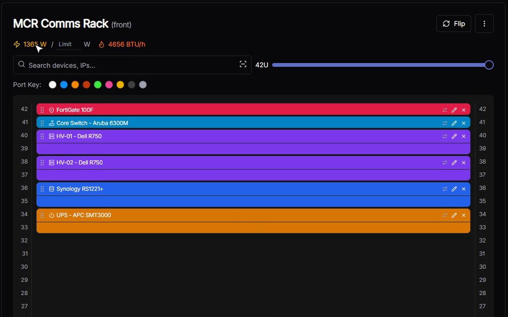

## Contents

- [Features](#features)
- [See it in action](#see-it-in-action)
- [Screenshots](#screenshots)
- [Free Plan](#free-plan)
- [Download](#download)
- [Getting Started](#getting-started)
- [Data & Backup](#data--backup)
- [Licensing](#licensing)
- [Support](#support)
- [Changelog](#changelog)

---

## Features

- **Drag-and-drop rack builder** — position devices exactly where they sit in the rack
- **50+ device types** — servers, switches, patch panels, PDUs, UPS, AV equipment, cameras, and more
- **Multi-site management** — organise racks across unlimited sites and locations
- **PDF export** — generate client-ready rack diagrams in one click
- **Port mapping** — document every RJ45, fibre, HDMI, and USB connection
- **IP address management** — subnets, an IP registry, duplicate-address flagging, and colour-coded VLANs
- **Engineer tools** — built-in subnet, CCTV storage, RAID capacity, and UPS runtime calculators
- **Audit log** — see who changed what and when
- **Asset licensing** — track software and hardware licence expiry dates
- **Custom devices** — add any device type not in the built-in library
- **Rack templates** — save and reuse common rack configurations
- **Multi-user** — invite your team with admin or viewer roles
- **Maintenance log** — record planned and completed maintenance per device
- **Offline-first** — runs entirely on your network, no cloud dependency

---

## See it in action

### Build a rack from scratch

Add a site, add a rack, drop devices in from the palette, fill in the details, and watch the power and heat totals add up.

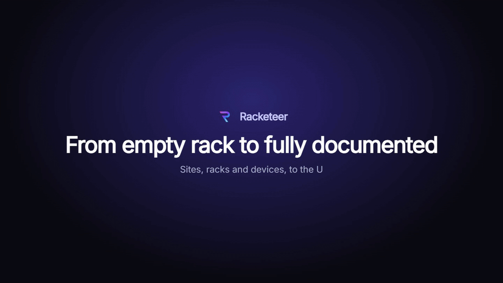

### Ports, patching and VLANs

Open any device to see its ports, pick where each cable goes, and tag the VLAN, cable type, cable ID and length. The link shows on both ends.

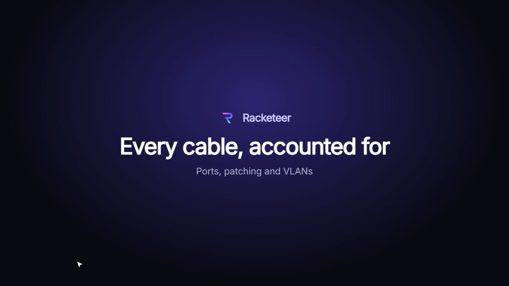

### IP address management

Subnets with live utilisation, a searchable registry of every IP, duplicate addresses flagged, and colour-coded VLANs.

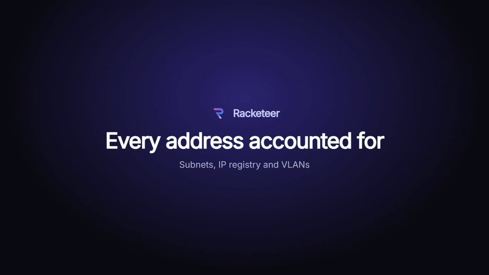

### Maintenance logs

See the next service date on every site, then log a visit straight from the rack: who did it, what was done, when it's due next, and a built-in inspection checklist where failures get a note.

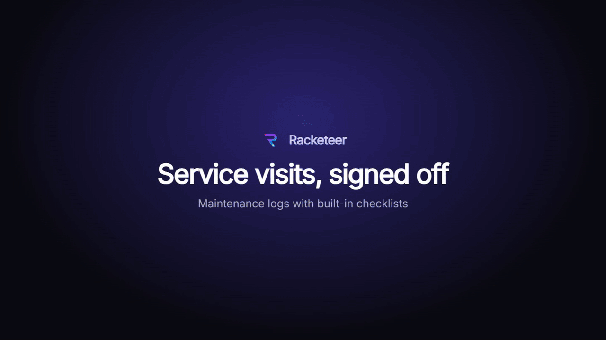

### Engineer tools

Subnet, CCTV storage and bandwidth, RAID capacity, and UPS runtime calculators, built in. No spreadsheets.

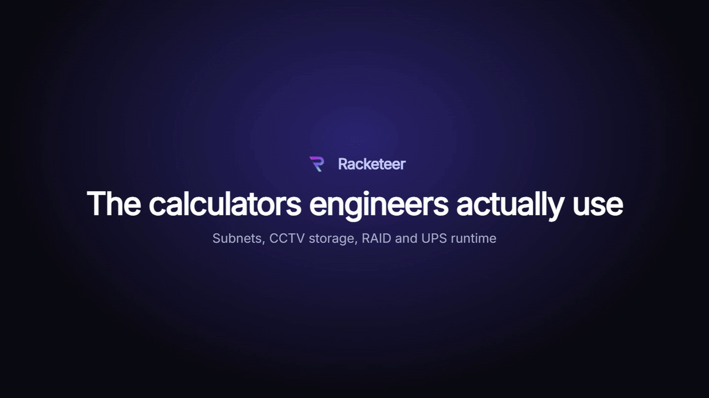

---

## Screenshots

### Dashboard

Every site, rack and device at a glance, with next service dates and IP conflict counts.

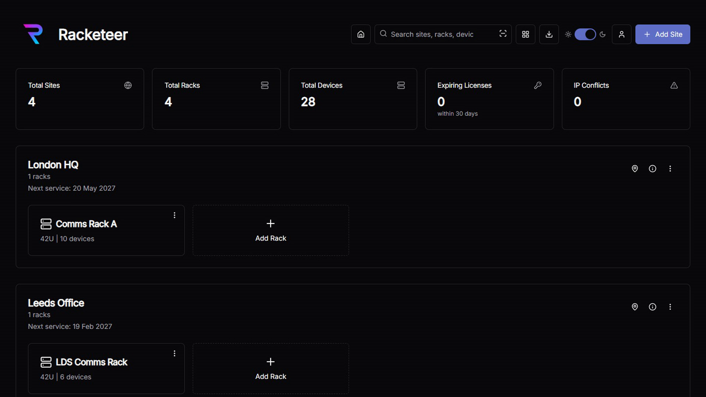

### IP registry

Every address with its gateway, VLAN, device, rack and site.

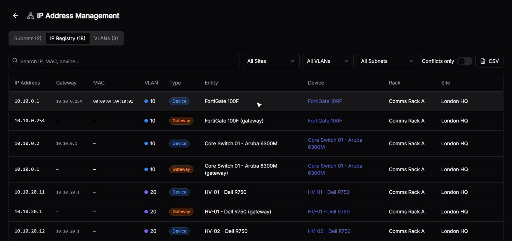

<table>
<tr>
<td width="50%" valign="top">
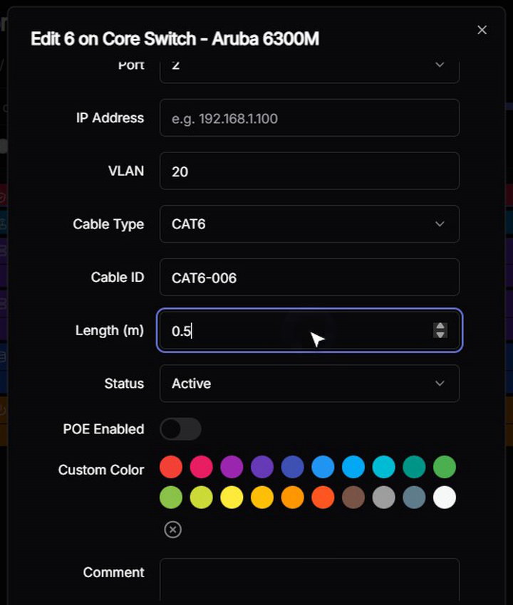 
<b>Port details</b> — connect a port and tag the VLAN, cable type, ID and length.
</td>
<td width="50%" valign="top">
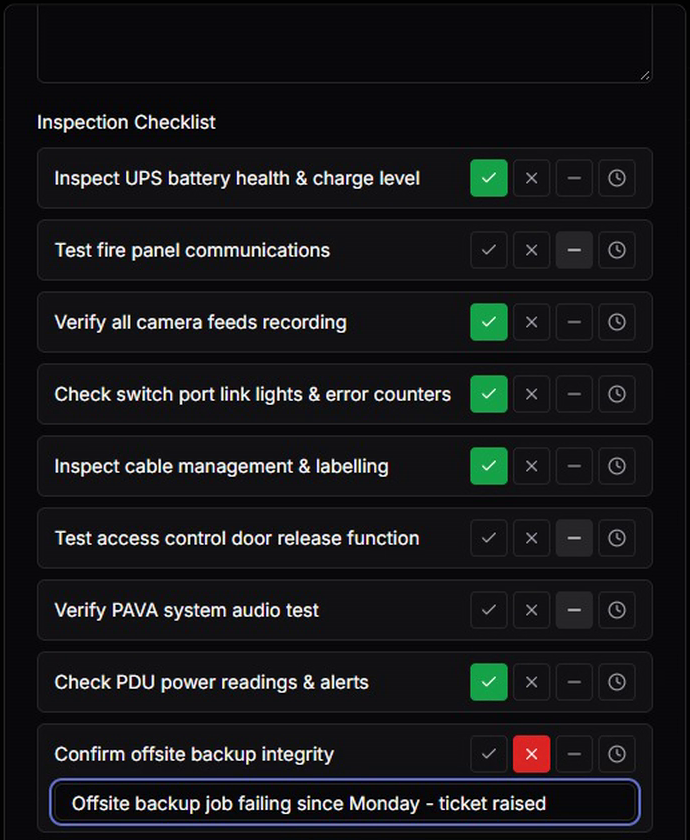 
<b>Maintenance checklist</b> — tick items off, and add a note to anything that fails.
</td>
</tr>
</table>

### Engineer tools

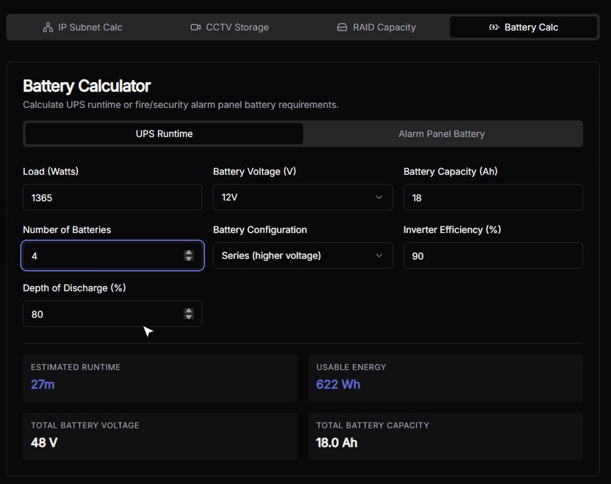

---

## Free Plan

No credit card. No trial timer. Just download and go.

| Plan | Users | Sites | Racks | Price |
|------|-------|-------|-------|-------|
| **Free** | 3 | 5 | 10 | £0 forever |
| Starter | 5 | Unlimited | Unlimited | £149/yr |
| Pro | 15 | Unlimited | Unlimited | £349/yr |
| Team | 30 | Unlimited | Unlimited | £599/yr |

---

## Download

### Windows Installer

Download the latest `.exe` from the [Releases page](https://github.com/Racketeer-io/Racketeer/releases/tag/latest).

Run the installer — Racketeer starts on `http://localhost:3000` automatically. No Docker, no containers — Node.js is bundled and it installs as a native Windows service.

Requires Windows 10/11 (64-bit). macOS and Linux support is coming soon.

---

## Getting Started

1. Download and install
2. Open `http://localhost:3000`
3. Create your first site and add a rack
4. Start adding devices

No account registration. Your data stays on your machine.

---

## Data & Backup

All data lives in `data/db.json` in the install directory. Back it up by copying that file. Restore by dropping it back in p

---

## Licensing

Racketeer is commercial software. The Free Plan is permanently free — no expiry, no card required. Paid plans are licensed a

[View pricing →](https://racketeer.io/#pricing)

---

## Support

- Docs: [racketeer.io/docs](https://racketeer.io/docs.html)
- Email: hello@racketeer.io
- Issues: [Racketeer-io/Racketeer/issues](https://github.com/Racketeer-io/Racketeer/issues)

---

## Changelog

Full history on the [Releases page](https://github.com/Racketeer-io/Racketeer/releases).

- **v0.3.2** — Free Plan (3 users, 5 sites, 10 racks, no license key required)
- **v0.3.1** — Maintenance log, subnet/VLAN documentation, improved PDF export
- **v0.3.0** — Multi-user accounts, audit log, asset licensing

---

*Built for the integrators who build the infrastructure everyone else relies on.*

